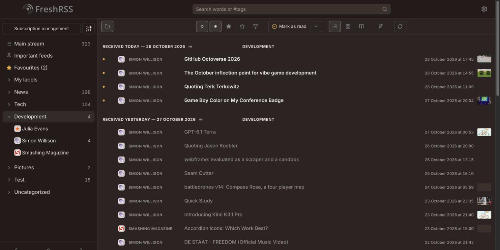

# Reed Compact

A compact sibling of [Reed](https://github.com/SiggeMcKvack/reed-theme) for [FreshRSS](https://freshrss.org). Each article in the list takes one line, about as tall as an Origine row (~40px):



`(read)(star) [icon] FEED NAME   Title  Excerpt…   time [thumb]`

Everything else is Reed. The list always spans the page instead of Reed's centred column; an opened article's text still follows **Settings → Display → Content width**. On phones the excerpt is hidden. Upstream already hides the feed name and time there.

## Installation

Reed Compact loads `../Reed/reed.css`, so Reed must be installed next to it in a folder named exactly `Reed`:

```
p/themes/Reed/
p/themes/Reed-Compact/
```

```sh
git clone --depth 1 https://github.com/SiggeMcKvack/reed-compact-theme.git p/themes/Reed-Compact
rm -rf p/themes/Reed-Compact/.git
```

With Docker, mount both folders:

```yaml
    volumes:
      - ./reed-theme:/app/www/p/themes/Reed
      - ./reed-compact-theme:/app/www/p/themes/Reed-Compact
```

Then choose **Reed Compact** under **Settings → Display → Theme** and do a hard refresh.

## Development

Regenerate the right-to-left stylesheet after editing `reed-compact.css`:

```sh
npx rtlcss@4.3.0 reed-compact.css reed-compact.rtl.css
```

## License

[AGPL-3.0](LICENSE), same as FreshRSS and Reed.
