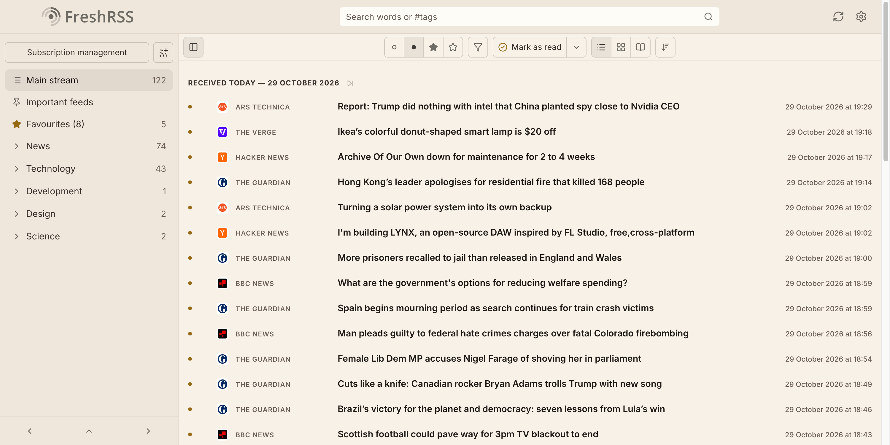

# Reed Compact

[Reed](https://github.com/SiggeMcKvack/reed-theme) for [FreshRSS](https://freshrss.org), with a denser article list: one line per article, so you see more of your feeds at a glance.

<p>
  
  
</p>

- Each article on a single line: read and favourite toggles, feed icon and name, title, excerpt, time and thumbnail
- The list uses the full width of the window
- Everything else, from colours and fonts to settings pages and dark mode, is the same as Reed

## Installation

Reed Compact builds on Reed, so install both, side by side:

```
p/themes/Reed/
p/themes/Reed-Compact/
```

Reed's folder must be named exactly `Reed`. Follow [Reed's installation steps](https://github.com/SiggeMcKvack/reed-theme#installation), then add this theme next to it:

```sh
git clone --depth 1 https://github.com/SiggeMcKvack/reed-compact-theme.git p/themes/Reed-Compact
rm -rf p/themes/Reed-Compact/.git
```

With Docker, mount both folders:

```yaml
    volumes:
      - ./reed-theme:/app/www/p/themes/Reed
      - ./reed-compact-theme:/app/www/p/themes/Reed-Compact
```

Then choose **Reed Compact** under **Settings → Display → Theme** and do a hard refresh (Cmd/Ctrl+Shift+R).

## Development

After editing `reed-compact.css`, regenerate the right-to-left version:

```sh
npx rtlcss@4.3.0 reed-compact.css reed-compact.rtl.css
```

## License

[AGPL-3.0](LICENSE), same as FreshRSS and Reed.
